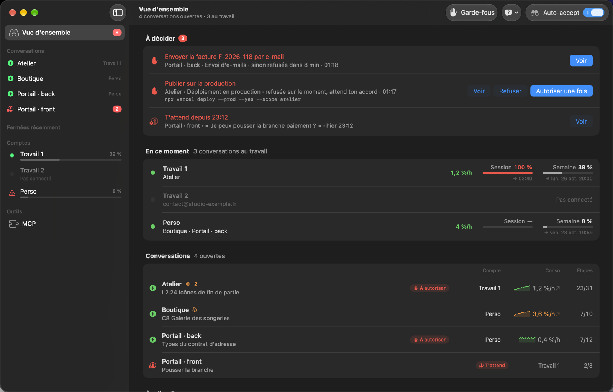
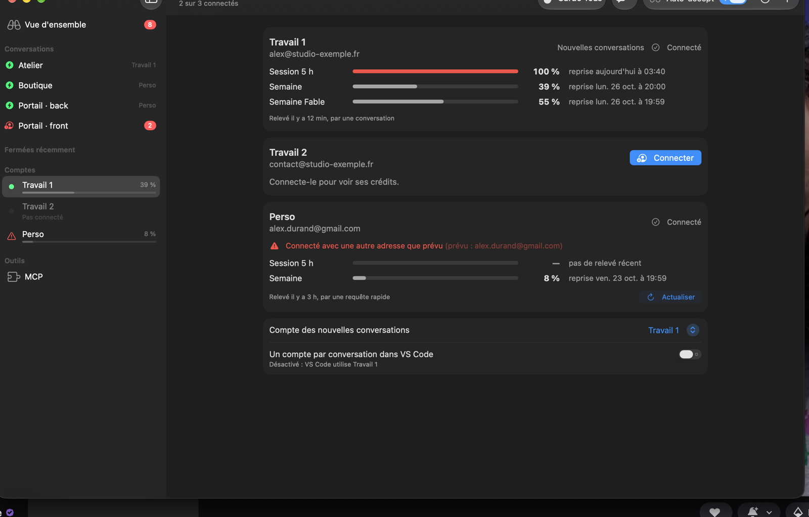
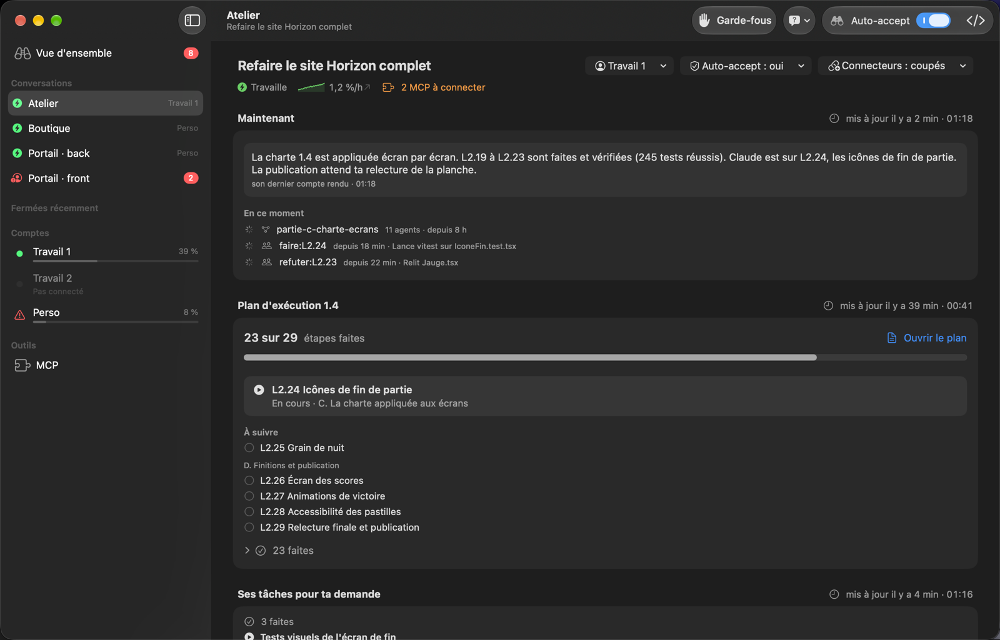
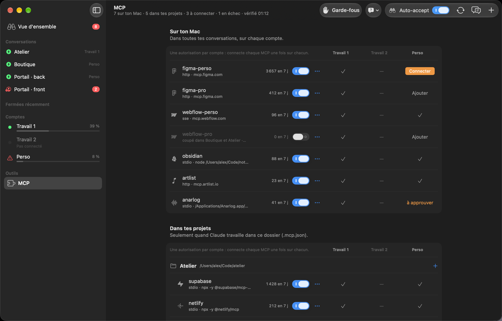

# Vigie

**Vigie veille sur Claude Code (et Codex) pendant que tu travailles… ou pendant que tu dors.**

Tu lances Claude Code pour plusieurs heures, et tu reviens pour trouver une fenêtre « Autoriser ? » qui attend depuis le début ? Vigie s'en charge à ta place. Les demandes sans risque sont acceptées toutes seules, et les actions sensibles t'attendent toujours. Tu suis tout dans une petite app Mac : tes conversations, ta consommation, tes comptes et tes MCP.

> **Bêta.** Vigie est en test. Il marche au quotidien, mais attends-toi à quelques angles encore à arrondir. Les retours sont les bienvenus (onglet *Issues*).



## Ce que fait Vigie

- **Il accepte pour toi** les demandes d'autorisation de Claude Code (commandes, fichiers, outils, MCP), dans toutes tes conversations, y compris celles déjà ouvertes.
- **Il garde pour toi les actions sensibles** : `sudo`, suppression de dossiers importants, `git push --force`, effacement de disque, paiements, envoi d'e-mails, publications, suppressions en ligne, scripts téléchargés lancés tels quels (`… | bash`), mots de passe du trousseau, ajout d'un MCP, réglages de Claude Code, de Vigie ou du shell. Elle s'affiche à la fois dans ta conversation (la fenêtre habituelle de Claude Code) et dans Vigie : tu réponds où tu veux, l'autre se ferme.
- **Il répond aux questions quand tu n'es pas là**, si tu le veux. Après un délai, Vigie choisit l'option que Claude recommande, et tu relis ce choix ensuite (« Ça me va » ou « Changer »).
- **Il te montre où en est chaque conversation** : ta demande, son message en direct, sa feuille de route, le fil de ce qu'elle a fait (commits, déploiements, tests, agents).
- **Il suit ta consommation** par compte et par conversation : session de 5 h, semaine, et l'heure exacte de remise à zéro.
- **Il gère plusieurs comptes Claude** : ils restent connectés en même temps, et tu choisis le compte de chaque conversation.
- **Il garde tes connexions** : une copie chiffrée de la connexion de chaque compte (Claude et Codex). Si une app la perd sans que tu te sois déconnecté (ça arrivait au redémarrage du Mac), Vigie la remet tout seul.
- **Il gère tes MCP**, avec leur état sur chaque compte et un bouton « Connecter » qui ouvre directement la page de connexion du service.

Tout se passe sur ton Mac : Vigie n'envoie tes conversations nulle part.

## Installation

Il te faut un Mac avec **macOS 26** (Tahoe) ou plus récent (Apple Silicon ou Intel), et Claude Code ou Codex : dans VS Code, dans l'app Claude ou dans l'app ChatGPT.

1. **Télécharge [Vigie.dmg](https://github.com/paulmailhes/vigie/releases/latest/download/Vigie.dmg)** (l'app est signée et notarisée par Apple).
2. Ouvre-le et **glisse Vigie dans Applications**.
3. Ouvre Vigie depuis Applications : elle s'installe toute seule (si Node.js 20 ou plus récent manque, elle pose sa propre copie officielle, vérifiée, dans `~/.vigie/node`, sans toucher au reste du Mac).

Tu préfères le Terminal ? La même chose en une commande :

```bash
curl -fsSL https://raw.githubusercontent.com/paulmailhes/vigie/main/install.sh | bash
```

L'app s'ouvre sur un court accueil :

1. ce que fait Vigie ;
2. avec quoi tu travailles (VS Code, app Claude, app ChatGPT) ;
3. les actions sensibles, qui restent à toi ;
4. tes comptes Claude, puis Codex s'il fait partie de tes outils ;
5. tes MCP ;
6. l'auto-accept, les mises à jour et les notifications.

Ensuite, Vigie vit dans la barre des menus (les jumelles).

**Mises à jour :** Vigie se met à jour tout seul (Réglages › Mises à jour) et te montre ce qui a changé. Tu peux aussi relancer la même commande. Tes réglages et ton historique sont gardés. Une mise à jour n'est installée que si son app est signée par l'équipe de Vigie et notarisée par Apple : un dépôt GitHub piraté ne pourrait rien faire installer.

## Plusieurs comptes Claude

Tu as un abonnement perso et un abonnement pro, ou plusieurs comptes de travail ? Ajoute-les dans Vigie, avec un nom et une adresse. Ton navigateur s'ouvre sur la page de connexion de Claude, et le compte reste connecté.

Active ensuite « Un compte par conversation dans VS Code » : chaque conversation choisit son compte dans son en-tête, et Vigie te montre sur quel compte elle tourne vraiment.



Changer le compte d'une conversation la relance sur l'autre compte avec tout son historique. Elle reprend à ton prochain message dans VS Code. Le nouveau compte relit alors toute la conversation, ce qui consomme des crédits : Vigie affiche le nombre de tokens à relire avant de basculer.

Une conversation sans compte choisi (une nouvelle, ou une ancienne jamais associée) part sur le **compte des nouvelles conversations**. Si son compte n'est pas connecté, elle part sur un compte qui l'est, et Vigie te le signale. Elle retrouve son compte dès qu'il est reconnecté.

**Le compte du Mac** (celui de `~/.claude`) est celui que VS Code regarde pour dire « connecté » : s'il tombe, toutes les fenêtres affichent « déconnecté », quel que soit le compte de la conversation. Vigie le surveille en premier, et la connexion lancée depuis VS Code arrive bien sur lui.

### Connexions gardées

Vigie garde une copie de la connexion de chaque compte, tenue à jour à chaque renouvellement. Si une app la perd sans que tu te sois déconnecté, Vigie la remet après l'avoir constaté deux fois (15 s d'écart), en attendant que Claude Code ait fini d'écrire. Il ne remet jamais :

- une connexion que tu as retirée toi-même (`/logout`, déconnexion de VS Code) ;
- une connexion refusée par Anthropic : le compte passe « à reconnecter », et « Connecter » ouvre la page de connexion sur le bon compte ;
- plus de trois fois par heure la même connexion.

Les copies sont chiffrées (AES-256-GCM) dans `~/.vigie/data/coffre`. Leur clé est rangée dans le trousseau du Mac (« Vigie connexions »). Rien n'est écrit en clair, rien ne passe dans les journaux, et rien ne quitte le Mac. Vigie ne se sert jamais de ces connexions : il ne fait que les recopier. Pour Codex, Vigie remet `~/.codex/auth.json` s'il est abîmé. S'il a été retiré, c'est une déconnexion, et Vigie la respecte.

Au démarrage du Mac, Vigie attend que tout soit calme avant ses propres relevés (crédits, MCP), qui lancent eux aussi Claude Code. Il les fait alors un compte à la fois.

Avec Nextcloud installé, Vigie pose aussi une entrée vide dans le trousseau, « 0 Vigie - leurre - ne pas supprimer ». Le client Nextcloud pour Mac a un bug ([nextcloud/desktop#10976](https://github.com/nextcloud/desktop/issues/10976)) : quand ton identifiant Nextcloud est ton nom de session, il écrase au démarrage la première entrée du trousseau à ton nom, celle de Claude Code. macOS te demande alors ton mot de passe à chaque lecture, puis la connexion se perd. Le leurre passe devant et c'est lui que Nextcloud prend. Sans Nextcloud, Vigie ne pose rien.

## Une conversation



- **Maintenant** : ta demande, depuis combien de temps elle y travaille, son dernier message en direct, ce qui en est sorti (commits, fichiers, tests, agents) et ce qui tourne en ce moment.
- **Feuille de route** : le document d'état qu'elle tient à jour (`ETAT.md`, `STATUS`, `ROADMAP`, `TODO`…), section par section, ou son plan en étapes.
- **Fil** : seulement les jalons, sans les centaines de petites actions.
- **Onglets** : Fichiers, Agents, Tests, MCP, Toutes les actions.

## MCP



Trois familles : **MCP de ce Mac** (dans toutes tes conversations), **MCP des projets** (fichier `.mcp.json` d'un dossier) et **MCP du compte** (branchés à ton compte sur claude.ai, coupés ou activés par défaut dans les nouvelles conversations).

Chaque MCP tient sur une ligne : « ✓ Tous tes comptes » quand il marche partout, sinon seuls les comptes à régler apparaissent, avec leur bouton (**Connecter**, **Ajouter**, **échec**). « Partout » le connecte sur tous tes comptes, l'un après l'autre. Chaque compte Claude garde sa propre autorisation : il faut connecter un MCP une fois par compte.

La **bibliothèque** (bouton « + ») propose les serveurs officiels des éditeurs (Notion, Figma, GitHub, Linear, Stripe…) : tu coches tes comptes, Vigie l'ajoute puis ouvre la page d'autorisation.

Les MCP qui passent par la **passerelle** de Vigie (une autorisation pour tous tes comptes, comme Webflow) suivent tes autorisations sans rien recharger dans VS Code :

- tu autorises un nouvel espace, tu en changes ou tu réautorises : les conversations ouvertes passent dessus d'elles-mêmes ;
- tu autorises un MCP alors que des conversations sont déjà ouvertes : leurs outils apparaissent tout seuls.

Les MCP que le service refuse de faire passer par Vigie (Figma) restent branchés compte par compte : après les avoir autorisés, une conversation déjà ouverte demande un « Reconnect » dans le panneau MCP de VS Code.

## Agents

Un **agent** est une recette préparée à l'avance, par exemple « Démarrer un projet client » : un champ où coller ce que tu as (questionnaire, e-mail du client, liens, notes) et glisser ses fichiers, les MCP dont il a besoin, ce qu'il va créer, puis une consigne pour Claude.

- Chaque agent est un fichier `AGENT.md`, rangé dans `~/.vigie/data/agents/<nom>/`. Son format est dans [docs/agents.md](docs/agents.md).
- La page Agents montre chaque agent et l'état de ses MCP.
- **Lancer** : tu choisis le dossier du projet et tu remplis le champ. Vigie crée le dossier, copie les fichiers glissés dans `sources/`, et y écrit la consigne remplie (`.vigie/agent-<nom>.md`, hors de git). Si une conversation existe déjà dans ce dossier, l'agent la reprend (son historique reste), ou en ouvre une nouvelle si tu préfères.
- **Dans VS Code ou dans l'app Claude**, au choix : Vigie ouvre le projet avec le message prêt, tu l'envoies, et la conversation suit la recette. Dans VS Code, Vigie attend que la fenêtre du projet soit prête avant d'y envoyer le message.
- **Bibliothèques** : pour partager tes agents avec ton équipe, range-les dans un dépôt git (un dossier par agent) et fais `git push`. Chaque collègue ajoute l'adresse du dépôt dans la page Agents : Vigie le récupère et le tient à jour toutes les heures, sans nouvelle version de Vigie. Ses identifiants git (gh, clé SSH) servent tels quels, et rien du dépôt n'est exécuté. Voir [docs/agents.md](docs/agents.md).

## Codex (OpenAI)

Vigie suit aussi tes conversations **Codex** (l'extension VS Code d'OpenAI), dans la même liste, avec une pastille « Codex ». Pour chacune, tu vois :

- ta demande et son message en direct ;
- son plan et ses commits ;
- ses agents ;
- sa consommation : la semaine de ton compte ChatGPT et l'heure de remise à zéro.

L'auto-accept marche aussi pour Codex : Vigie branche son hook dans `~/.codex/hooks.json`. Les demandes d'autorisation sont acceptées, et les actions sensibles t'attendent dans Vigie, comme pour Claude.

**Une étape à faire une fois :** Codex demande de faire confiance à un nouveau hook. Dans le Terminal, lance `codex`, tape `/hooks` et accepte celui de Vigie.

Une conversation ne peut pas passer de Claude à Codex : leurs historiques sont incompatibles.

## Comment ça marche

- Un **hook** de Claude Code (`hook.mjs`) reçoit chaque demande d'autorisation et répond à la place de la fenêtre. En cas de doute, il ne répond rien : la fenêtre normale de Claude Code s'affiche, jamais l'inverse.
- Un **moteur local** (`server.mjs`, Node.js, sans dépendance) lit les conversations de Claude Code sur ton Mac et sert l'app sur `http://127.0.0.1:4777`, en local uniquement.
- L'**app Mac** (SwiftUI) affiche le tout et envoie tes réglages au moteur.
- Le **lanceur de comptes** (`bin/claude-account-wrapper`, facultatif) démarre chaque conversation VS Code sur le compte que tu lui as choisi, ou sur un compte connecté si le sien ne l'est pas.
- Le **coffre des connexions** (`lib/vault.mjs`) garde une copie chiffrée de la connexion de chaque compte et la remet si une app la perd. Il publie l'état des connexions dans `~/.vigie/data/connexions.json` (connecté ou non, jamais rien de secret), que lit le lanceur.

L'app embarque le moteur et l'installe dans `~/.vigie` au premier lancement ; ses données (réglages, historique) sont dans `~/.vigie/data`, lisibles par toi seul. Le hook est branché dans `~/.claude/settings.json` (et `~/.codex/hooks.json` pour Codex). Une sauvegarde de ces fichiers est faite à chaque modification.

### Sécurité

- **API locale protégée** : le moteur n'écoute que ton Mac, refuse les pages web (hôte et origine vérifiés) et exige un jeton d'accès (`~/.vigie/data/api-token`, lisible par toi seul) : un autre compte du Mac, un conteneur ou une commande lancée au hasard n'ont rien sans lui. Claude Code refuse de l'ouvrir avec son outil de lecture, et le garde-fou retient les commandes courantes qui le liraient ; ce n'est pas un rempart contre une conversation décidée à le chercher (voir la limite plus bas).
- **Mises à jour vérifiées** : signature de l'app par l'équipe de Vigie, accord de Gatekeeper, version attendue ; seul le moteur scellé dans l'app est installé.
- **MCP par Vigie** : un MCP qui se présente comme un autre service, ou qui désigne une adresse du réseau local ou un fichier du Mac, n'est jamais connecté.
- **Limite des garde-fous** : ils protègent des erreurs et des consignes piégées ordinaires (une page web qui demande à Claude de lancer une commande). Une conversation dont les commandes sont acceptées d'office a tes droits sur le Mac : un programme vraiment décidé à contourner Vigie le pourrait. Pour du code dont tu ne te fies pas, coupe l'auto-accept.

### Sobriété

Vigie ralentit de lui-même quand tu ne le regardes pas : fenêtre cachée ou recouverte, il ne relit plus ses pages et ne relit la vue d'ensemble que toutes les 15 s (60 s écran éteint). Ses relevés de fond (état des MCP, consommation des comptes au repos) passent une fois par heure, un à la fois, en priorité basse.

## Désinstaller

```bash
~/.vigie/scripts/uninstall.sh          # retire le hook et le moteur, quitte l'app ; garde tes réglages
~/.vigie/scripts/uninstall.sh --tout   # efface aussi ~/.vigie, l'app et la clé du coffre des connexions
```

Claude Code redevient exactement comme avant, et les conversations ouvertes reprennent tout de suite le fonctionnement normal.

## Développer

```bash
git clone https://github.com/paulmailhes/vigie.git && cd vigie
node --test test/            # tests du moteur et du hook
./scripts/install.sh         # installe depuis les sources (construit l'app : il faut Xcode ou ses outils)
```

L'app se construit avec `mac/build-app.sh`, et la documentation de l'API locale est dans [docs/api-v2.md](docs/api-v2.md). Une version publiable (app signée et notarisée, `Vigie.dmg` et l'archive des mises à jour) se prépare avec `scripts/release.sh <version>`.

## Licence

MIT. Voir [LICENSE](LICENSE).
